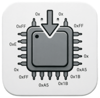
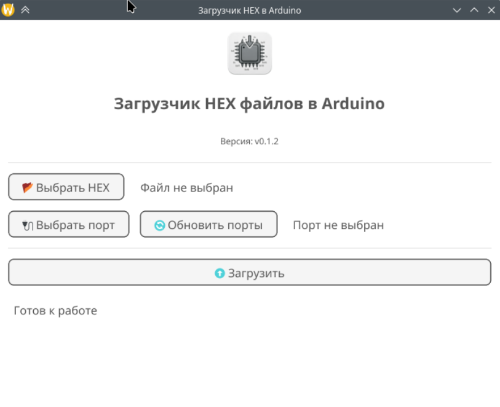
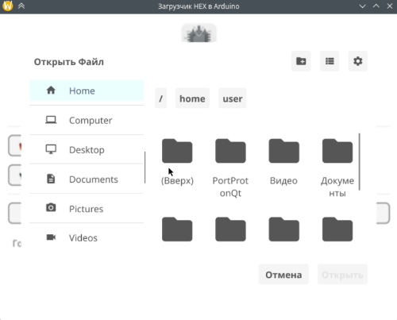
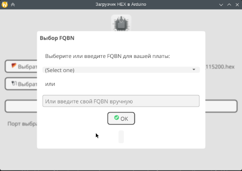
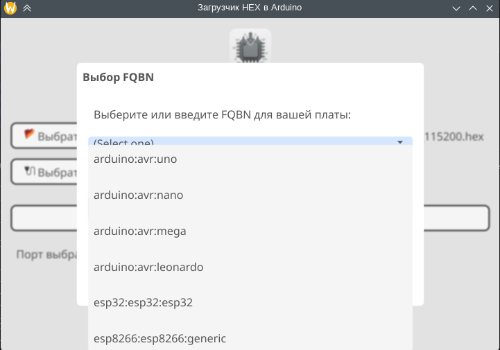
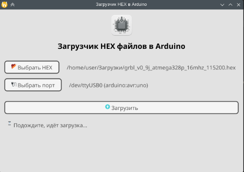
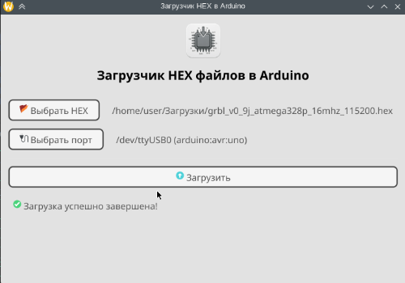

# Hex Loader

[](https://github.com/USER/REPO/actions/workflows/ci.yml)
[](LICENSE)
[](https://go.dev/)
[](https://fyne.io/)

<p align="center">
  
</p>

**GUI-загрузчик HEX-файлов** для плат Arduino на базе **Arduino CLI**, написанный на **Go** с использованием **Fyne**. Работает в Linux, macOS и Windows.

## 🚀 Возможности

- 📂 Выбор HEX-файла через стандартный диалог (фильтр `.hex`).
- 💾 Сохранение последнего выбранного файла между запусками.
- 🔌 Обнаружение подключённых плат (даже не распознанных `arduino-cli`).
- 🛠️ Ручной выбор `FQBN` для нераспознанных плат: из списка или вводом своего.
- ⬆️ Загрузка прошивки через `arduino-cli` с индикацией процесса.
- 🌗 Адаптивная светлая/тёмная тема — подстраивается под оформление ОС.
- 🛡️ Проверка прав: предупреждает, если пользователь не в группе `dialout`/`uucp`.
- 📴 Работает офлайн — использует локально установленные ядра и инструменты.
- 🐧 Проверено на ALT Linux 11 и Ubuntu 22.04/24.04.

## 📸 Скриншоты

| Главное окно | Выбор платы | Выбор FQBN |
|:---:|:---:|:---:|
|  |  |  |

| Загрузка | Успех | Тёмная тема |
|:---:|:---:|:---:|
|  |  |  |

## 📦 Установка

Скачайте нужный файл из [Releases](https://github.com/USER/REPO/releases).

### Debian / Ubuntu / Mint
```bash
sudo apt install ./hex-loader_0.1.0_amd64.deb
```

### Fedora / RHEL / openSUSE / ALT Linux
```bash
sudo dnf install ./hex-loader-0.1.0.x86_64.rpm
```
или
```bash
sudo rpm -i ./hex-loader-0.1.0.x86_64.rpm
```

### AppImage (любой дистрибутив Linux, без установки)
```bash
chmod +x Hex_Loader-v0.1.0-x86_64.AppImage
./Hex_Loader-v0.1.0-x86_64.AppImage
```

### Бинарники
| Платформа | Файл |
|-----------|------|
| Linux x86_64 | `hex-loader-linux-x64` |
| macOS (Apple Silicon) | `hex-loader-macos-arm64` |
| Windows x86_64 | `hex-loader-windows-x64.exe` |

После скачивания сделайте файл исполняемым (`chmod +x`) и запустите.

### Сборка из исходников
```bash
git clone https://github.com/USER/REPO.git
cd hex-loader
go build -buildvcs=false -ldflags="-s -w" -o hexloader .
./hexloader
```

Требуются Go 1.23+ и GUI-зависимости:
```bash
# ALT Linux
epmi --auto gcc-c++ golang libXcursor-devel libX11-devel libGL-devel \
  libXrender-devel libXfixes-devel libXi-devel libXinerama-devel \
  libXrandr-devel libwayland-egl-devel libXxf86vm-devel \
  libxkbcommon-devel libwayland-cursor-devel

# Ubuntu/Debian
sudo apt install build-essential golang libgl1-mesa-dev libegl1-mesa-dev \
  xorg-dev libwayland-dev libxkbcommon-dev wayland-protocols
```

## ⚙️ Требования

- **`arduino-cli`** установлен и доступен в `PATH`.
- **Linux:** пользователь в группе `dialout` (или `uucp`). Проверить:
  ```bash
  groups | grep -E 'dialout|uucp'
  ```
  Если нет:
  ```bash
  sudo usermod -a -G dialout $USER
  ```
  После этого нужно выйти и зайти заново.

## 🧪 Как проверить работу

1. Создайте тестовый скетч `big_sketch.ino`:
   ```cpp
   // Занимает ~30 КБ памяти Arduino Uno
   const int arraySize = 15000;
   unsigned char bigArray[arraySize];

   void setup() {
     Serial.begin(9600);
     for (int i = 0; i < arraySize; i++) {
       bigArray[i] = i % 256;
     }
     Serial.println("Большой скетч загружен!");
   }

   void loop() {
     delay(1000);
   }
   ```
2. В **Arduino IDE**: *Скетч → Экспортировать скомпилированный бинарный файл* — получите `.hex`.
3. Запустите **Hex Loader**, выберите `.hex`, выберите порт, нажмите «Загрузить».

Проверить, что `arduino-cli` видит плату:
```bash
arduino-cli board list
```

## 🌍 Проблема с загрузкой индексов Arduino CLI в РФ

Официальные серверы `downloads.arduino.cc` возвращают **403 Forbidden** для запросов из РФ. Варианты решения:

1. **VPN** — самый надёжный способ: запустите `arduino-cli core update-index` через VPN, затем работайте офлайн.
2. **Ручная загрузка индексов** — скачайте с VPN и распакуйте в `~/.arduino15`:
   - [`package_index.tar.bz2`](https://downloads.arduino.cc/packages/package_index.tar.bz2)
   - [`library_index.tar.bz2`](https://downloads.arduino.cc/libraries/library_index.tar.bz2)
3. **Перенос `~/.arduino15/packages/`** с машины, где ядра уже установлены. После переноса восстановите права:
   ```bash
   chown -R $USER:$USER ~/.arduino15/
   find ~/.arduino15/packages/ -type f -exec chmod 644 {} \;
   find ~/.arduino15/packages/ -type d -exec chmod 755 {} \;
   find ~/.arduino15/packages/ -name "avrdude" -exec chmod +x {} \;
   find ~/.arduino15/packages/ -name "*.so*" -exec chmod +x {} \;
   find ~/.arduino15/packages/ -path "*/bin/*" -exec chmod +x {} \;
   ```

## 📄 Лицензия

Проект распространяется под лицензией **MIT**. См. [LICENSE](LICENSE).

## 🙏 Благодарности

- [Fyne](https://fyne.io/) — кроссплатформенный GUI-фреймворк.
- [Arduino CLI](https://github.com/arduino/arduino-cli) — работа с платами и загрузка.
- [nFPM](https://nfpm.goreleaser.com/) — сборка `.deb` и `.rpm`.
- [appimagetool](https://github.com/AppImage/appimagetool) — сборка AppImage.
- AI-ассистенты **DeepSeek AI** и **Qwen3.8-Max** — помощь в разработке.

Есть идеи или нашли баг? Создавайте [Issue](https://github.com/USER/REPO/issues) или присылайте Pull Request.

## 🛠️ Планы

- [x] Сохранение последнего выбранного FQBN
- [x] Встроенная иконка в окне приложения
- [x] Расширенное поле выбора FQBN с контуром
- [x] Адаптивная светлая/тёмная тема
- [x] Сборка AppImage
- [x] Упаковка в `.deb`
- [x] Упаковка в `.rpm`
- [x] Бинарники для Linux/macOS/Windows
- [ ] Тестирование бинарника на разных версиях macOS
- [ ] Тестирование бинарника на разных версиях Windows
- [ ] Тестирование AppImage в ALT Linux 10 и других дистрибутивах
- [ ] Проверка установки RPM в ALT Linux 10/11
- [ ] Сборка пакета Stapler для ALT Space
- [ ] Публикация в AppImageHub